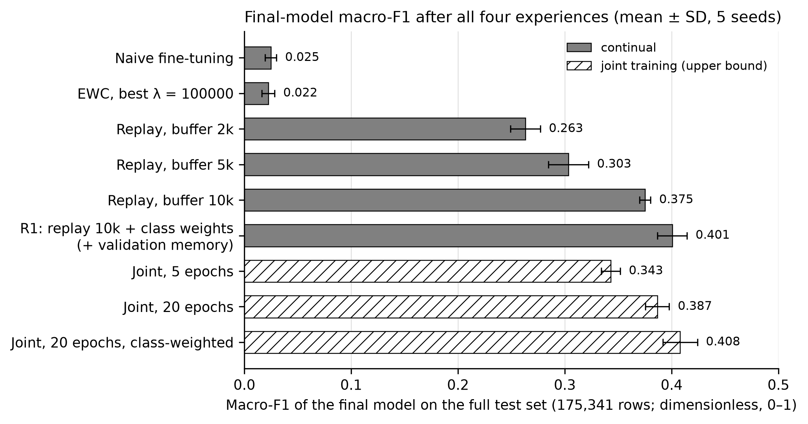
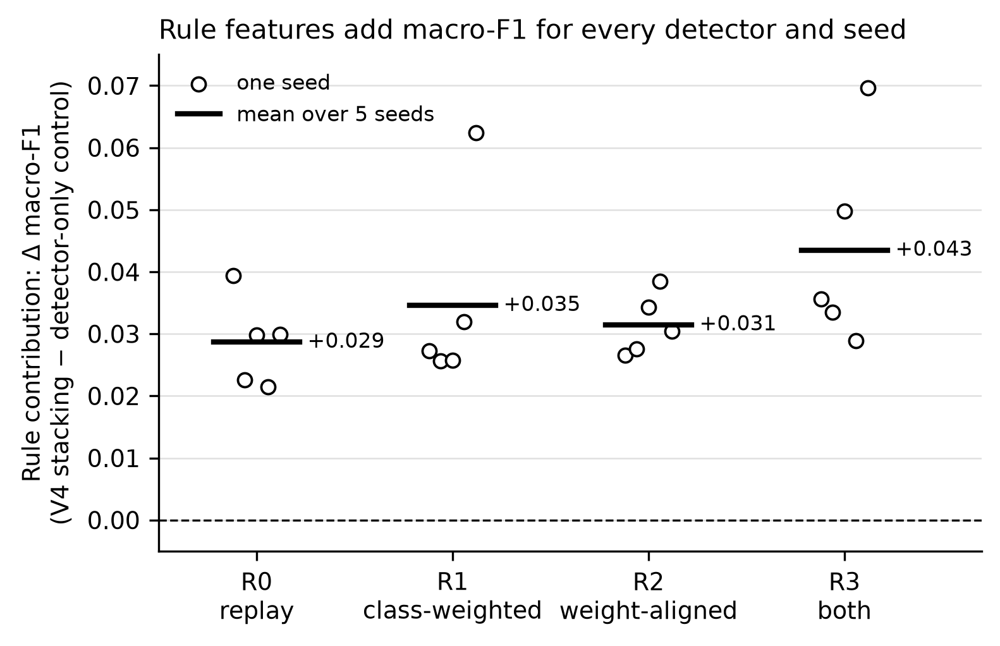
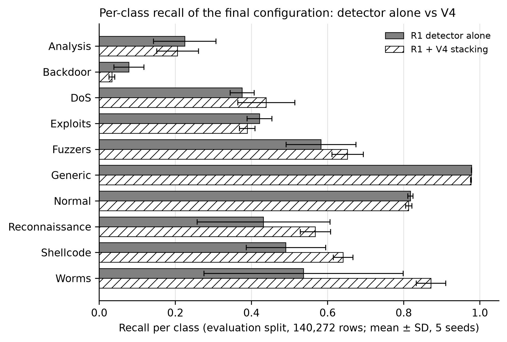
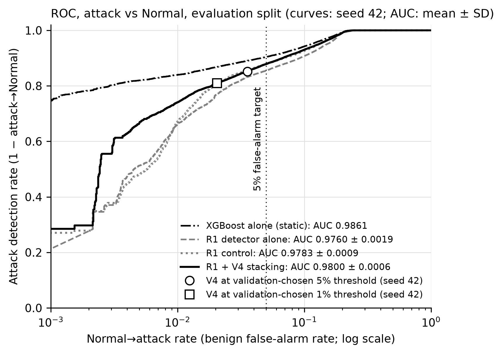

# Adaptive Neuro-Symbolic Intrusion Detection System

This project detects network attacks on UNSW-NB15 with a neural detector that learns attack classes one group at a time (class-incremental continual learning), plus a knowledge base of human-readable rules induced automatically from the traffic. Phase II re-evaluated the system with a stricter protocol: the *final* model after all four experiences, scored on the full test set.

Under that evaluation, experience replay with class weighting (detector R1) approaches the joint-training upper bound: macro-F1 0.4005 ± 0.0139 against 0.4079 ± 0.0162. In the continual setting, stacking rule features on the detector adds a small macro-F1 gain (+0.0346 ± 0.0157 for R1) that is positive in every seed, every detector variant and every ablation. A static XGBoost model remains the strongest model overall (macro-F1 0.5255 ± 0.0016), and neither the rules nor XGBoost transfer to a different network dataset.

- **Full results**, with the source file of every number: [`results/PHASE2_RESULTS_v2.md`](results/PHASE2_RESULTS_v2.md)
- **Report text** (methodology, discussion, limitations, Phase I errata): [`docs/phase2_report_sections.md`](docs/phase2_report_sections.md)

All values below are mean ± sample SD over seeds 42, 1, 2, 3, 4 unless marked n = 1.

---

## Contents

1. [Key results](#key-results)
2. [Scorecard](#scorecard)
3. [Figures](#figures)
4. [Limitations](#limitations)
5. [Future work](#future-work)
6. [Requirements](#requirements)
7. [Installation](#installation)
8. [Dataset setup](#dataset-setup)
9. [Project structure](#project-structure)
10. [Reproduce the final configuration](#reproduce-the-final-configuration)
11. [Phase I pipeline](#phase-i-pipeline)
12. [Troubleshooting](#troubleshooting)

---

## Key results

**Final configuration (continual).** Detector R1 is NeuralIDS trained with:
- experience replay (10,000-row buffer)
- class-weighted loss
- a held-out validation memory of 200 rows per class, at most half of each class

The knowledge base is `continual_kb_v1_gain_clean.db`: 90 active rules, validated by normalised precision gain, with the validation-memory rows excluded. Fusion V4 stacks rule features onto the detector with a logistic regression fitted on the validation memory only.

**Static reference.** A 10-class XGBoost trained once on all training data. It is not a continual model.

| System | Model (final model after Experience 4, full test set, 175,341 rows) | Macro-F1 |
|---|---|---|
| Continual | Naive fine-tuning | 0.0248 ± 0.0053 |
| Continual | EWC, best λ (100000) | 0.0224 ± 0.0060 |
| Continual | Replay, buffer 10,000 | 0.3751 ± 0.0052 |
| Continual | **R1**: replay 10,000 + class weights + validation memory | **0.4005 ± 0.0139** |
| Upper bound (not continual) | Joint training on all experiences, 20 epochs, class-weighted | 0.4079 ± 0.0162 |
| Static (reference) | XGBoost, 10-class | 0.5255 ± 0.0016 |

Naive fine-tuning and EWC predict almost only the last experience's classes (recency share 0.9895 and 1.0000, against a true share of 0.1109).

### Rule contribution
Measured for the final configuration (R1) on the evaluation split (140,272 rows).

| | Macro-F1 |
|---|---|
| R1 detector alone | 0.4008 ± 0.0136 |
| Control: the same stacker on the detector's log-probabilities, no rule features | 0.3958 ± 0.0179 |
| V4 with rule features | 0.4303 ± 0.0049 |

- **V4 minus control: +0.0346 ± 0.0157**, positive in 5/5 seeds. This is the effect of the rule features alone, with the same detector and calibration data.
  - For the other detector variants R0, R2 and R3 it is +0.0287, +0.0315 and +0.0435, each positive in 5/5 seeds.
- **V4 minus detector alone: +0.0295 ± 0.0149.** This is smaller because, for R1, recalibrating without rules (the control) is slightly below the detector alone.
- **Static setting.** Rules do not improve XGBoost alone (macro-F1 0.5267, n = 1). No fusion variant has a 95% CI above 0; V4, the best variant on the calibration data, changes it by −0.0100 [−0.0189, −0.0004].

### Benign false alarms and missed attacks
Evaluation split, 44,800 Normal flows.

| Configuration | False alarms (Normal → attack) | Missed attacks (attack → Normal) |
|---|---|---|
| Continual R1 + V4, default decision rule (argmax) | 0.1873 ± 0.0081 | 0.0176 ± 0.0050 |
| Continual R1 + V4, threshold for a 5% false-alarm target | 0.0347 ± 0.0059 | 0.1518 ± 0.0138 |
| Static XGBoost alone (n = 1) | 0.0168 | 0.1429 |

- **Default decision rule.** Most of these false alarms are already present in the R1 detector alone (0.1827 ± 0.0067), before any rules are added.
- **5% operating point.** The threshold is chosen on the validation memory only, never on test data, and the realised rate stays within 5% in 5/5 seeds. The cost is lower macro-F1 (0.3807 ± 0.0062) and much weaker Fuzzers detection (0.9454 → 0.2967).
- **ROC-AUC, attack vs Normal:**

  | Model | ROC-AUC |
  |---|---|
  | R1 detector alone | 0.9760 ± 0.0019 |
  | R1 control | 0.9783 ± 0.0009 |
  | R1 + V4 | 0.9800 ± 0.0006 |
  | Static XGBoost (n = 1) | 0.9861 |

### Ablations and external validation
- **TTL features.** Dropping `ct_state_ttl` leaves the rule contribution positive: +0.0374, 5/5 seeds. Dropping the whole TTL group (`sttl`, `dttl`, `ct_state_ttl`) does three things:
  - lowers static XGBoost macro-F1 by 0.0130 ± 0.0016
  - lowers V4 from 0.4303 to 0.4139
  - raises the rule contribution to +0.0485, positive in 5/5 seeds
- **KS drift threshold.** Experience 4 (Fuzzers, Shellcode, Worms) has a mean-KS drift score of only 0.1845 ± 0.0029.
  - At threshold 0.20 or 0.25 it is not flagged (0/5 seeds), and the knowledge base loses its 16 Fuzzers rules.
  - V4 then drops from 0.4303 to 0.4174, and the rule contribution from +0.0346 to +0.0216 (still 5/5 seeds).
- **NetFlow-v2 (static).** Trained on NF-UNSW-NB15-v2 and tested on NF-ToN-IoT-v2, using the shared 39 NetFlow features.
  - Benign false-alarm rate: 0.8725 ± 0.0098 for XGBoost, 0.9512 ± 0.0067 for V4.
  - On the training network itself, rules add nothing: V4 minus control is −0.0008 ± 0.0013, positive in 1/5 seeds.

---

## Scorecard

These are the eight practical tests from Phase I, re-run on the final configuration. Test 1 is split into three lines, so there are 10 verdict lines in total. Phase I values are copied from `results/final_test_report.md`; Phase II values come from `results/final_test_report_phase2_v3.md`.

| Test | System | Target | Phase I | Phase II | Phase II verdict |
|---|---|---|---|---|---|
| 1a False alarm rate (XGBoost + V2) | static | Normal→attack < 0.05 | PASS 0.0318 (macro-FPR); Normal→attack 0.0201 | 0.0179 | **PASS** |
| 1b False alarm rate (R1 + V4), default argmax | continual | Normal→attack < 0.05 | not measured | 0.1873 ± 0.0081 | **FAIL** |
| 1b-op Same, at the validation-chosen 5% operating point | continual | Normal→attack < 0.05 | not measured | 0.0347 ± 0.0059 (5/5 seeds ≤ 0.05) | **PASS** |
| 2 Known-attack detection (DoS and Reconnaissance recall) | static | ≥ 0.80 | FAIL 0.6502 | 0.7222 | **FAIL** |
| 3 New-attack adaptation (Experience 4 accuracy) | continual | ≥ 0.80 | PASS 0.9299 | 0.6531 ± 0.0394 | **FAIL** |
| 4 Drift detection | continual | flagged at Exp 2, 3, 4 | PASS | flagged at [2, 3, 4] | **PASS** |
| 5 Forgetting retention (final model, Exp 1–3) | continual | ≥ 0.80 | FAIL 0.5514 | 0.6664 ± 0.0083 | **FAIL** |
| 6 Rule quality (stored precision / coverage) | continual (KB) | precision ≥ 0.90, coverage ≥ 0.05 | PASS 0.9589 / 0.4821 | 0.9832 / 0.3224; on test: mean lift 1.97, mean gain +0.168 | **PASS** |
| 7 Rule conflict handling | code (unit tests) | tests pass | PASS | pytest exit 0 | **PASS** |
| 8 External generalisation (NetFlow-v2) | static | Benign FPR < 0.05 and DR ≥ 0.80 | CONDITIONAL 0.2366 (TON_IoT, 6 hand-mapped features) | FPR 0.9512 ± 0.0067, DR 0.7812 ± 0.0055 | **FAIL** |

**Result: 5/10 verdict lines pass.** Counted as eight tests, with Test 1 judged on 1a and 1b-op, that is **4/8**. Without the operating point (the v2 scorecard) it is 3/8. Phase I recorded 5/8.

**Why Phase II scores differently.** Phase II applies stricter, corrected metric definitions:
- **Test 3.** Phase I's 0.9299 came from a replay detector with a strong recency bias. It put 0.4525 ± 0.0148 of its predictions into the Experience 4 classes, whose true share is 0.1109.
- **Test 5.** Retention is now the final model's accuracy on earlier experiences. The Phase I report's "PASS 0.9449" was an average of each model's accuracy on its own experience; under the final-model definition, the Phase I model scores 0.5514.
- **Test 1.** It now counts benign false alarms (Normal→attack) instead of the macro-averaged FPR, which hides them.

**Test 6 note.** Stored absolute precision is inflated by class imbalance. A rule that fires on almost every row inherits the base rate of a dominant class as its precision. The test-set lift and normalised gain of the final knowledge base (`results/fusion/kb_rule_stats_final.md`) are the more informative measures.

---

## Figures

The figures are copies of `results/figures_phase2/` (which is git-ignored).



*F1. Final-model macro-F1 on the full test set for each continual method and the joint-training upper bound (mean ± SD, 5 seeds).*



*F2. Rule contribution (V4 minus the detector-only control) for each seed and detector variant R0–R3.*



*F5. Per-class recall of the final configuration: R1 detector alone vs R1 + V4 (evaluation split, mean ± SD). V4 raises recall for rare classes such as Worms and Shellcode, and lowers it most for Backdoor, Exploits and Analysis.*



*F7. ROC of attack vs Normal on the evaluation split, with V4's validation-chosen 5% and 1% operating points. The curves and the markers are for **seed 42 only**; the AUC values in the legend are mean ± SD over 5 seeds.*

---

## Limitations

- **The continual system stays below static XGBoost.**
  - Macro-F1 on the evaluation split: R1 + V4 0.4303 ± 0.0049 vs XGBoost 0.5267.
  - ROC-AUC: R1 + V4 0.9800 ± 0.0006 vs XGBoost 0.9861.
  - In F7 (seed 42), the XGBoost curve lies above the continual curves at low false-alarm rates.
- **High benign false-alarm rate at the default decision rule.** R1 + V4 flags 0.1873 ± 0.0081 of Normal flows as attacks.
  - A validation-chosen threshold fixes this for a 5% target, but at a miss rate of 0.1518 ± 0.0138.
  - A 1% target is not met reliably (0.0151 ± 0.0043, 0/5 seeds), because each memory holds only 200 Normal flows.
- **Backdoor and Analysis remain poorly detected.**
  - V4 recall stays at or below 0.2056 (Analysis) and 0.0601 (Backdoor) for every detector variant, and no continual knowledge base has rules for either class.
  - V4 lowers R1's Backdoor recall from 0.0779 to 0.0331.
- **Rare-class results rest on few rows.** The validation memory holds 22 Worms rows per seed, and the NetFlow-v2 test split has 24 Worms rows.
- **Retention comes from replay, not from rules.**
  - Naive fine-tuning reaches macro-F1 0.0248 ± 0.0053; replay with a 10,000-row buffer reaches 0.3751 ± 0.0052.
  - Final-model retention (Test 5) is 0.6664 ± 0.0083 with V4 and 0.6655 ± 0.0159 for the R1 detector alone.
- **No cross-dataset transfer.** Rules and XGBoost both fail on NF-ToN-IoT-v2 (Benign false-alarm rate 0.9512 ± 0.0067 and 0.8725 ± 0.0098). Only one source–target pair was tested.
- **Dataset partition.** In our copy of UNSW-NB15 the CSV names are swapped relative to the official partition: `UNSW_NB15_training-set.csv` has 82,332 rows and `UNSW_NB15_testing-set.csv` has 175,341. We train on the 82,332-row file and test on the 175,341-row file. The results are internally consistent but not directly comparable with the literature.

## Future work

- **Continual XGBoost.** Combine replay with trees added at each experience, to bring the static model's strength into the continual setting.
- **Class-aware novelty detection for drift.** The label-free mean-KS score under-reacts when new attack classes look similar to existing traffic.
- **Rules for rare classes.** For example, class-balanced candidate generation or per-class support thresholds, so that Analysis, Backdoor, Shellcode and Worms get rules.
- **Few-shot target adaptation.** Update the fusion layer or detector from a handful of labelled flows from a new network.
- **Stronger stackers.** For example, gradient-boosted or attention-based combiners over rule activations, while keeping predictions explainable by rules.

---

## Requirements

- Windows, macOS or Linux.
- Python ≥ 3.9 (`pyproject.toml`). The results in this repository were produced in the project venv: Python 3.14.2, PyTorch 2.14.0 (CPU build), XGBoost 3.4.1, scikit-learn 1.9.1, NumPy 2.5.3 and SHAP 0.52.0, as recorded in `results/environment_timing.json`.
- **GPU (optional).** NeuralIDS uses an NVIDIA GPU with CUDA if PyTorch can see one; otherwise it runs on the CPU.

## Installation

```bash
# 1. Clone
git clone https://github.com/NischayCSM/adaptive-neuro-symbolic-ids.git
cd adaptive-neuro-symbolic-ids

# 2. Create and activate a virtual environment
python -m venv venv
venv\Scripts\activate          # Windows
source venv/bin/activate       # macOS / Linux

# 3. Install PyTorch first, matching your system (see https://pytorch.org/get-started/locally/)
pip install torch                                                   # CPU only
pip install torch --index-url https://download.pytorch.org/whl/cu121  # example CUDA build
python -c "import torch; print(torch.cuda.is_available())"         # True if a CUDA GPU is usable

# 4. Install the other dependencies and the project itself (makes src/ importable)
pip install -r requirements.txt
pip install -e .
```

> **SHAP.** The `shap` package depends on `numba`/`llvmlite`. On some managed Windows machines, Application Control blocks these DLLs. In that case the pipeline skips SHAP-based rule generation, logs `SHAP rule generation unavailable... Skipping this generator.`, and continues with the other rule generators.

## Dataset setup

### UNSW-NB15 (required)

1. Download the dataset from https://www.kaggle.com/datasets/mrwellsdavid/unsw-nb15 (this needs a free Kaggle account).
2. Copy the two files into `data/raw/`:

```
data/raw/
├── UNSW_NB15_training-set.csv   ← 82,332 rows in our copy
└── UNSW_NB15_testing-set.csv    ← 175,341 rows in our copy
```

In our copy these names are swapped relative to the official partition; see [Limitations](#limitations). The pipeline trains on the 82,332-row file.

### NetFlow-v2 (Phase II external validation, optional)

Phase II's cross-dataset experiment uses `NF-UNSW-NB15-v2.csv` and `NF-ToN-IoT-v2.csv`, the NetFlow-v2 versions with a shared feature set.
- These files are large and are **kept outside the repository**, by default in `C:\datasets\netflow\` (change this with `--source-dir`).
- `src/evaluation/netflow_prepare.py` reads them in place and writes the sampled, preprocessed arrays to `data/processed_netflow/` (git-ignored).

### TON_IoT (Phase I external validation only, optional)

This is needed only for the Phase I pipeline's external-validation step; Phase II does not use it.
1. Download the network flow CSV from https://www.kaggle.com/datasets/arnobbhowmik/ton-iot-network-dataset.
2. Rename it to `TON_IoT_Network.csv` and place it in `data/external/`.

## Project structure

```
adaptive-neuro-symbolic-ids/
├── configs/                  rules.yaml (rule-score weights, min support, acceptance threshold), continual.yaml (experience → classes)
├── data/                     (git-ignored)
│   ├── raw/                  UNSW-NB15 CSVs (you place them here)
│   ├── processed/            scaled arrays, pipeline, knowledge bases (*.db)
│   ├── processed_no_ttl/, processed_no_ttl_group/   feature-ablation datasets
│   ├── processed_netflow/    NetFlow-v2 samples (raw CSVs live outside the repo)
│   └── external/             TON_IoT_Network.csv (Phase I only)
├── docs/
│   ├── phase2_report_sections.md   Phase II report text
│   └── figures/              figures used in this README
├── src/
│   ├── preprocessing/        loading, cleaning, encoding, scaling, feature drops
│   ├── models/               XGBoost / RandomForest / MLP baselines, NeuralIDS (PyTorch)
│   ├── rules/                rule generators, validator (precision / lift / gain checks), knowledge base
│   ├── reasoning/            fusion.py (Phase I fuser), fusion_variants.py (V0–V4, control)
│   ├── continual/            experiences, drift detection, continual KB pipeline, replay / EWC / joint training
│   ├── evaluation/           evaluation scripts (Phase II scripts listed below)
│   └── run_all.py            Phase I orchestrator
├── tests/                    test_knowledge_base.py (scorecard Test 7)
├── results/                  (git-ignored) all generated outputs
│   ├── PHASE2_RESULTS_v2.md  consolidated Phase II results and number sources
│   ├── final_test_report_phase2_v3.md   Phase II scorecard
│   ├── continual/            final-model evaluation, checkpoints
│   ├── fusion/               fusion variants, detector variants, false alarms, operating point, KB statistics
│   ├── ablations/            KS threshold, ct_state_ttl, TTL group
│   ├── external_netflow/     NetFlow-v2 data card and evaluation
│   └── figures_phase2/       figures F1–F7
├── notebooks/, experiments/
├── run.bat, run.sh           Phase I pipeline launchers
└── requirements.txt, pyproject.toml
```

### Phase II scripts and flags

| Script / flag | Purpose |
|---|---|
| `src.continual.replay_finetune --buffer-size N --val-memory-per-class 200 --val-memory-max-fraction 0.5 [--class-weighted] [--weight-align] [--processed-dir DIR]` | Replay detector with a held-out validation memory; R1 = `--class-weighted`, R2 = `--weight-align`, R3 = both |
| `src.continual.continual_pipeline --kb-name F [--gain-check] [--lift-check] [--mixed-validation] [--retire] [--exclude-train-rows NPZ ...] [--drift-threshold T] [--processed-dir DIR]` | Continual KB build; the drift flag gates rule induction |
| `src.continual.joint_train --epochs N [--class-weighted] [--save-checkpoint]`, `src.continual.ewc_finetune --ewc-lambda L --save-checkpoint`, `src.continual.run_naive_seeds` | Joint upper bound, EWC and naive baselines |
| `src.preprocessing.run_pipeline --drop-features COL ... --output-dir DIR` | Feature-ablation datasets (`data/processed_no_ttl`, `data/processed_no_ttl_group`) |
| `src.evaluation.run_final_model_eval` | Final model on the full test set for every continual method |
| `src.evaluation.run_final_model_eval_v2` | Re-runs the KB-fused rows of `final_model_eval` with the deterministic fuser → `results/continual/final_model_eval_v2.{csv,md}` |
| `src.evaluation.run_fusion_variants` / `run_fusion_legal` / `run_fusion_final` | Fusion V0–V4 and control: test-calibrated / validation memory / leakage-free KB |
| `src.evaluation.run_detector_variants` | R0–R3 detectors, control and V4 |
| `src.evaluation.kb_rule_stats [--kbs NAME=FILE ...] [--out-name N] [--gain]` | KB size, match fractions, test lift / gain |
| `src.evaluation.run_ks_threshold`, `run_no_ttl`, `run_no_ttl_group` | Ablations (drift threshold, ct_state_ttl, TTL group) |
| `src.evaluation.netflow_prepare [--source-dir DIR]`, `netflow_kb`, `run_netflow_eval`, `run_netflow_indomain_binary` | NetFlow-v2 external validation |
| `src.evaluation.final_tests --phase2 [--v2]` | 8-test scorecard on the final configuration → `results/final_test_report_phase2.md` (without `--phase2`: the Phase I scorecard). `--v2` scores Test 1 by the benign false-alarm (Normal→attack) rate for the static and the continual configuration → `results/final_test_report_phase2_v2.md` |
| `src.evaluation.run_benign_fpr` | Normal→attack and attack→Normal rates of the final settings → `results/fusion/benign_fpr.{csv,md}` |
| `src.evaluation.run_operating_point [--redo-figure]` | Operating points on 1 − P(Normal) with thresholds chosen on the validation memory, ROC-AUC → `results/fusion/operating_point.{csv,md}`, `results/figures_phase2/F7_roc.png` |
| `src.evaluation.make_scorecard_v3` | v2 scorecard plus Test 1b at the validation-chosen 5% operating point → `results/final_test_report_phase2_v3.md` |
| `src.evaluation.make_phase2_figures [--force]` | Figures F1–F6 → `results/figures_phase2/` |

Always run scripts as modules (`python -m src.evaluation.<name>`), not as file paths.

## Reproduce the final configuration

Run these in Windows PowerShell, from the project root, with the venv.
- **Set `PYTHONHASHSEED=0` first.** Several scripts relaunch themselves with it, but training, KB building and `run_final_model_eval` do not.
- Each step needs the outputs of the steps before it. The scorecard cross-checks its numbers against `fusion_final.csv` and `detector_variants.csv`, so the whole chain is needed.

```powershell
$env:PYTHONHASHSEED = "0"
$py = "venv\Scripts\python.exe"
$seeds = 42, 1, 2, 3, 4

# 1. Data, static models, static KB
& $py -m src.preprocessing.run_pipeline
& $py -m src.models.baselines
& $py -m src.rules.static_rule_extraction

# 2. Phase I-style continual KBs (continual_kb.db is required by replay_finetune)
& $py -m src.continual.continual_pipeline
& $py -m src.continual.continual_pipeline --kb-name continual_kb_v1_seed42.db
& $py -m src.continual.continual_pipeline --mixed-validation --kb-name continual_kb_v2.db
& $py -m src.continual.continual_pipeline --mixed-validation --retire --kb-name continual_kb_v3.db

# 3. Replay detectors and the joint upper bound; creates the calibration/evaluation split
foreach ($s in $seeds) {
    & $py -m src.continual.replay_finetune --seed $s
    & $py -m src.continual.replay_finetune --seed $s --buffer-size 5000
    & $py -m src.continual.replay_finetune --seed $s --buffer-size 10000
    & $py -m src.continual.joint_train --seed $s --epochs 20 --class-weighted
}
& $py -m src.evaluation.run_fusion_variants

# 4. Validation memory (200 per class) and lift-checked KBs
& $py -m src.continual.continual_pipeline --lift-check --kb-name continual_kb_v1_lift.db
& $py -m src.continual.continual_pipeline --mixed-validation --lift-check --kb-name continual_kb_v2_lift.db
foreach ($s in $seeds) { & $py -m src.continual.replay_finetune --seed $s --buffer-size 10000 --val-memory-per-class 200 }
& $py -m src.evaluation.run_fusion_legal

# 5. R0 detectors, then KBs that exclude their validation memories (leakage-free)
foreach ($s in $seeds) {
    & $py -m src.continual.replay_finetune --seed $s --buffer-size 10000 --val-memory-per-class 200 --val-memory-max-fraction 0.5
}
$vm = foreach ($s in $seeds) { "results/continual/replay_checkpoints/valmem_seed${s}_buf10000_valmem200_maxfrac0.5.npz" }
& $py -m src.continual.continual_pipeline --kb-name continual_kb_v1_clean.db --exclude-train-rows $vm
& $py -m src.continual.continual_pipeline --gain-check --kb-name continual_kb_v1_gain_clean.db --exclude-train-rows $vm
& $py -m src.continual.continual_pipeline --mixed-validation --gain-check --kb-name continual_kb_v2_gain_clean.db --exclude-train-rows $vm
& $py -m src.evaluation.run_fusion_final

# 6. R1 (final detector), R2, R3
foreach ($s in $seeds) {
    $base = @("--seed", $s, "--buffer-size", "10000", "--val-memory-per-class", "200", "--val-memory-max-fraction", "0.5")
    & $py -m src.continual.replay_finetune @base --class-weighted
    & $py -m src.continual.replay_finetune @base --weight-align
    & $py -m src.continual.replay_finetune @base --class-weighted --weight-align
}
& $py -m src.evaluation.run_detector_variants

# 7. NetFlow-v2 (CSV files outside the repo, default C:\datasets\netflow)
& $py -m src.evaluation.netflow_prepare --source-dir C:\datasets\netflow
& $py -m src.evaluation.netflow_kb
& $py -m src.evaluation.run_netflow_eval
& $py -m src.evaluation.run_netflow_indomain_binary

# 8. Phase II scorecard; benign false-alarm rates; v2 scorecard (Test 1 = Normal->attack rate)
& $py -m src.evaluation.final_tests --phase2
& $py -m src.evaluation.run_benign_fpr
& $py -m src.evaluation.final_tests --phase2 --v2
& $py -m src.evaluation.run_operating_point
& $py -m src.evaluation.make_scorecard_v3
```

The remaining Phase II tables and figures need additional runs:
- naive (`run_naive_seeds`), EWC (`ewc_finetune --save-checkpoint`, λ = 5000, 1e5, 1e6, 1e7) and joint training (`joint_train --save-checkpoint`, `--epochs 20`), all for `run_final_model_eval`
- `kb_rule_stats`
- the ablations `run_ks_threshold`, `run_no_ttl` and `run_no_ttl_group`

Each script's docstring lists its prerequisites. Then run `& $py -m src.evaluation.make_phase2_figures`. Several evaluation scripts refuse to overwrite their existing outputs, so work in a fresh clone.

## Phase I pipeline

The original one-command pipeline (`run.bat` on Windows, `run.sh` on macOS/Linux, orchestrated by `src/run_all.py`) produces the **Phase I** outputs.

```bash
.\run.bat                       # Windows: all stages
./run.sh --stage milestone3     # macOS/Linux: one stage
```

| Stage | What runs | Key outputs (Phase I) |
|---|---|---|
| `preprocessing` | Load UNSW-NB15, encode, scale, save arrays | `data/processed/` |
| `baselines` | RandomForest, XGBoost, MLP, NeuralIDS | `results/models/`, `results/neural_model/` |
| `milestone2` | Static rule extraction, XGBoost + fusion | `results/milestone2_comparison.csv` |
| `milestone3` | Phase I continual pipeline, forgetting, α ablation, TON_IoT validation | `results/continual/`, `results/milestone3_*.csv` |
| `milestone4` | CLI demo, Phase I 8-test scorecard | `results/demo_run.jsonl`, `results/final_test_report.md` |

Phase II supersedes the Phase I headline numbers in these files:
- **Scorecard.** `results/final_test_report.md` is the Phase I scorecard (5/8); see [Scorecard](#scorecard) for the corrected Phase II version.
- **Retention.** Phase I retention and accuracy figures were averages of each model's accuracy on its own experience, not retention. See the errata in `docs/phase2_report_sections.md`.
- **α-sweep.** The Phase I static α-sweep is in `results/static_alpha_sweep.csv`. Its "symbolic only" row (α = 0.0) depended on Python's hash seed through the old fuser tie-break (`results/fusion/tie_break_check.md`).

**Configuration.** `configs/rules.yaml` sets the rule-score weights (precision 0.4, coverage 0.3, stability 0.2, conflict 0.2), the minimum support (50) and the acceptance threshold (0.6). `configs/continual.yaml` maps the four experiences to their classes.

## Troubleshooting

- **"Dataset not found".** Download the CSVs from Kaggle manually; see [Dataset setup](#dataset-setup).
- **`ModuleNotFoundError: No module named 'src'`.** Run scripts as modules (`python -m src.evaluation.run_benign_fpr`), not as file paths, and make sure you ran `pip install -e .`.
- **`ERROR: ... already exists; not overwriting`.** Several Phase II evaluation scripts refuse to overwrite their outputs. Move the old file away, or work in a fresh clone.
- **Results differ slightly from `results/`.**
  - Set `PYTHONHASHSEED=0` before every step.
  - Retraining on a machine with a different CPU thread count can change floating-point results.
  - Compare against saved checkpoints rather than retrained models.
- **SHAP blocked by Application Control (Windows).** `SHAP rule generation unavailable: DLL load failed` means a security policy blocks `llvmlite.dll`. The pipeline continues without the SHAP rule generator.
- **`PermissionError (WinError 32)` on a `.db` file.** OneDrive (or an open SQLite viewer) is locking the knowledge base. Pause OneDrive sync, close the viewer, and re-run. A project folder outside OneDrive avoids this.
- **`torch.cuda.is_available()` returns `False`.** The CPU build of PyTorch is installed. Reinstall a CUDA build that matches your driver (check it with `nvidia-smi`), or keep running on the CPU.
- **XGBoost `use_label_encoder` warning.** This is a harmless deprecation warning.
- **Phase I pipeline aborts at external validation.** `data/external/TON_IoT_Network.csv` is missing. This affects only the Phase I TON_IoT step.
- **An `ERROR:` line in the console.** Scripts exit with an error instead of substituting placeholder data when an input is missing. Fix that step before reading downstream results.

## Citation

```
Adaptive Neuro-Symbolic Intrusion Detection System:
Bridging Interpretability and Continual Learning
UNSW-NB15 Dataset · NetFlow-v2 External Validation · 2026
https://github.com/NischayCSM/adaptive-neuro-symbolic-ids
```
